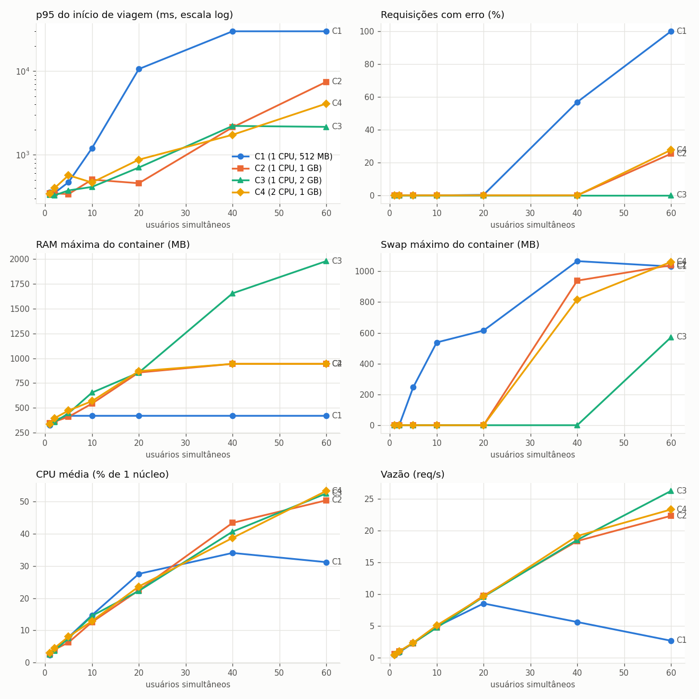

# Demanda, Provisionamento e Desempenho: aplicação memory-bound

Grupo: [integrantes e matrículas]

Colchetes marcam o que só existe depois do LCC3. Os gráficos de `results/graficos/` saem de `python analysis/analyze.py` com os dados da VM.

## 1. Aplicações desenvolvidas

### 1.1 Descrição e características

Servidor de rotas com trânsito para o estado da Paraíba, backend de um app de navegação. Python 3.10, FastAPI, um processo.

- Mapa do OpenStreetMap com 214.373 nós e 565.101 arestas, carregado na RAM (290 MB de RSS).
- `POST /viagens` abre uma viagem. O servidor calcula a árvore de caminhos até o destino (Dijkstra no grafo invertido) e a guarda até a viagem terminar.
- `GET /viagens/{id}/rota` devolve a rota da posição atual pela árvore guardada.
- `DELETE /viagens/{id}` encerra a viagem e libera a árvore.
- `GET /rota` (rota avulsa) e `GET /alcance` (isócrona) completam a API.
- Cada viagem ocupa as arestas da sua rota. O tempo de cada aresta segue a fórmula BPR: `tempo_livre × (1 + 0,15 × (fluxo / 2)^4)`. Rotas cheias ficam lentas e os recálculos desviam delas.

Perfil de memória:

```
memória ≈ 290 MB + 20 a 30 MB × viagens abertas + 35 a 50 MB × buscas em andamento
```

- Abrir uma viagem custa cerca de 250 ms de CPU. Um recálculo pela árvore custa 1,5 ms.
- Um motorista dirigindo gasta pouca CPU e segura a sua árvore na memória.
- Sem RAM, o Linux usa swap. Sem swap, o OOM killer mata o processo, o systemd o reinicia e as viagens abertas se perdem.

Mecanismos descartados (`docs/calibracao.md`, seção 3):

- Rota avulsa, 17 MB por requisição: a memória só acumulava com a CPU em 100%.
- Foto do trânsito por requisição, 49 MB por requisição: mesma limitação.
- Vários processos: cada um carrega o mapa de novo e o trânsito deixa de ser compartilhado. Medição avulsa com 8 rotas: 4 threads 1,80 s, 4 processos 0,74 s, sequência 1,76 s.

### 1.2 Monitoramento

| o quê | onde | ferramenta |
|---|---|---|
| latência média, p50, p95, p99 (geral, início e recálculo), req/s, taxa de erro | hospedeiro | k6, só a fase de medição |
| memória usada, swap, CPU da VM, RSS e hora de início do processo, a cada 1 s | hospedeiro, porta 8081 | `deploy/monitor.py`, processo separado da aplicação |
| CPU, memória livre, buffers, cache, swap e swap in/out, a cada 1 s | VM | `vmstat 1` (com ssh) |
| RSS, pico de RSS, CPU do processo, viagens abertas, a cada 1 s | VM | `/metrics` da aplicação (com ssh) |
| processo morto por falta de memória | VM | `systemctl show rotas -p NRestarts` e `journalctl -k` |

Sem ssh na VM, os reinícios são contados pelas mudanças da hora de início do processo vista pelo monitor.

## 2. Configuração da VM e deploy

### 2.1 Etapas de configuração da VM

Passo a passo em `deploy/README.md`, seções 1 e 2.

1. Cópia de `ubuntu_serve_2204_poi.vdi` de `/local/uasc/images` para `/tmp`. [PRINT]
2. Criação da VM `vm-rotas`: Linux, Ubuntu (64-bit), pasta `/tmp`, 1 CPU, 1024 MB, disco existente. [PRINT] [PRINT] [PRINT]
3. Login com `osboxes` / `osboxes.org`. [PRINT]
4. nginx na VM: `sudo apt install nginx`, `sudo systemctl status nginx`, `curl localhost:80`. [PRINT]
5. `curl localhost:80` no hospedeiro falha: sem redirecionamento, o hospedeiro não alcança a VM. [PRINT]
6. VM desligada, Rede > Avançado > Redirecionamento de portas: 8088 para 80 (nginx), 8080 para 8000 (aplicação), 8081 para 8001 (monitor), 2222 para 22 (ssh). [PRINT]
7. `curl localhost:8088` no hospedeiro devolve a página do nginx. [PRINT]
8. nginx desligado (`sudo systemctl disable --now nginx`) para não ocupar memória nos cenários.

O roteiro testa a porta 80 no hospedeiro. Um usuário sem root no Linux não abre porta abaixo de 1024, por isso o hospedeiro usa 8088.

### 2.2 Aplicação na VM

- Serviço systemd `rotas` (porta 8000, `Restart=always`, mapa `data/paraiba.map.gz`).
- Serviço systemd `rotas-monitor` (porta 8001), que responde mesmo com a aplicação ocupada ou reiniciando.

### 2.3 Requisitos e deploy

- Requisitos: Ubuntu 22.04, Python 3.10, FastAPI 0.143.0, uvicorn 0.54.0, psutil 7.2.2. Mapa e wheels no repositório; a instalação funciona sem internet.
- Cópia: `scp -P 2222 -r memory-bound-rotas osboxes@localhost:~/`. [PRINT]
- Instalação: `./deploy/install.sh`. [PRINT da saída]
- Verificação: `systemctl status rotas` na VM e `curl localhost:8080/health` no hospedeiro. [PRINT] [PRINT]
- Memória e swap da VM: [`free -h` e `swapon --show`]. O swap é o mesmo em todos os cenários.

## 3. Teste de stress

### 3.1 Cenários

| cenário | CPU | RAM | papel |
|---|---|---|---|
| C1 | 1 | [512] MB | pouca memória |
| C2 | 1 | 1 GB | configuração do roteiro, referência |
| C3 | 1 | 2 GB | dobro de RAM |
| C4 | 2 | 1 GB | dobro de CPU |

C2 contra C3 isola o efeito da memória. C2 contra C4 isola o efeito da CPU.

### 3.2 Como os testes foram feitos

- Carga gerada no hospedeiro, fora da VM, com k6 (`load/viagem.js`) pela porta 8080.
- Cada usuário virtual abre uma viagem, recalcula [6] vezes com [5] s entre recálculos e encerra. Origem e destino vêm de 300 pares fixos.
- Níveis: 1, 2, 5, 10, 20, 40 e 60 usuários simultâneos.
- Cada nível: serviço reiniciado, [35] s de aquecimento fora da medição, 60 s de medição, [3] repetições.
- Troca de cenário e níveis automatizados por `experiments/run_all.sh` com `VBoxManage`. [PRINT do teste de fumaça] [PRINT do início]
- Hospedeiro: [modelo da CPU, núcleos, RAM, de `results/raw/execucao.txt`].

### 3.3 Resultados

Prova prévia no Docker (Mac, limites equivalentes aos cenários, uma repetição, `docs/perfil_local.md`). Serviu para escolher cenários e níveis antes do LCC3.



Resultados na VM:

| cenário | 1º nível com swap | 1º nível com erros | p95 do início com 60 usuários | req/s com 60 usuários | erros com 60 usuários | CPU média com 60 usuários |
|---|---|---|---|---|---|---|
| C1 | [ ] | [ ] | [ ] | [ ] | [ ] | [ ] |
| C2 | [ ] | [ ] | [ ] | [ ] | [ ] | [ ] |
| C3 | [ ] | [ ] | [ ] | [ ] | [ ] | [ ] |
| C4 | [ ] | [ ] | [ ] | [ ] | [ ] | [ ] |


[PRINT do `experiments/acompanhar.sh` num nível de C1 com swap ou reinício]

[Pontos de `results/observacoes.md`.]

### 3.4 Interpretação e conclusões

[Conferir com os números da VM. A prova local mostrou:]

- A memória cresce com os usuários: em C3, de 341 MB com 1 usuário para 1.981 MB com 60.
- Mais demanda degrada o desempenho quando a memória acaba. C1 entra em swap com 5 usuários e, com 10, o p95 do início sobe de 355 ms para 1,2 s com CPU em 15%.
- Com o swap esgotado, o processo é morto e as viagens abertas se perdem: 25% de erros em C2 com 60 usuários.
- Dobrar a RAM (C3) zerou os erros com 60 usuários e baixou o p95 do início de 7,5 s para 2,2 s.
- Dobrar a CPU (C4) manteve swap e erros no nível de C2 (28% contra 25%).
- A CPU média ficou abaixo de 55% em todos os níveis. O recurso que limita a aplicação é a memória.

### 3.5 Limitações

- O k6 roda no mesmo hospedeiro da VM e disputa CPU com ela. A disputa é igual em todos os cenários.
- O tamanho do swap da VM muda o nível em que o processo morre.
- Com 40 usuários ou mais, inícios de viagem simultâneos disputam a CPU e o p95 sobe mesmo sem swap (C3 na prova local).
- Um processo Python usa um núcleo por vez para o Dijkstra. A segunda CPU de C4 atende só o kernel, o swap e o resto da VM.
- A medição de threads contra processos foi avulsa e não tem script no repositório.
